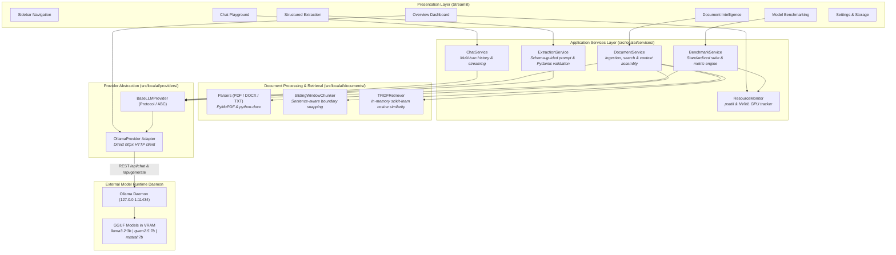
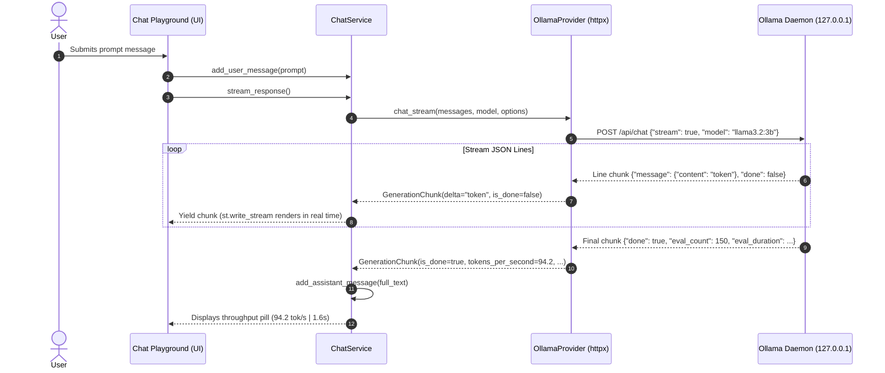
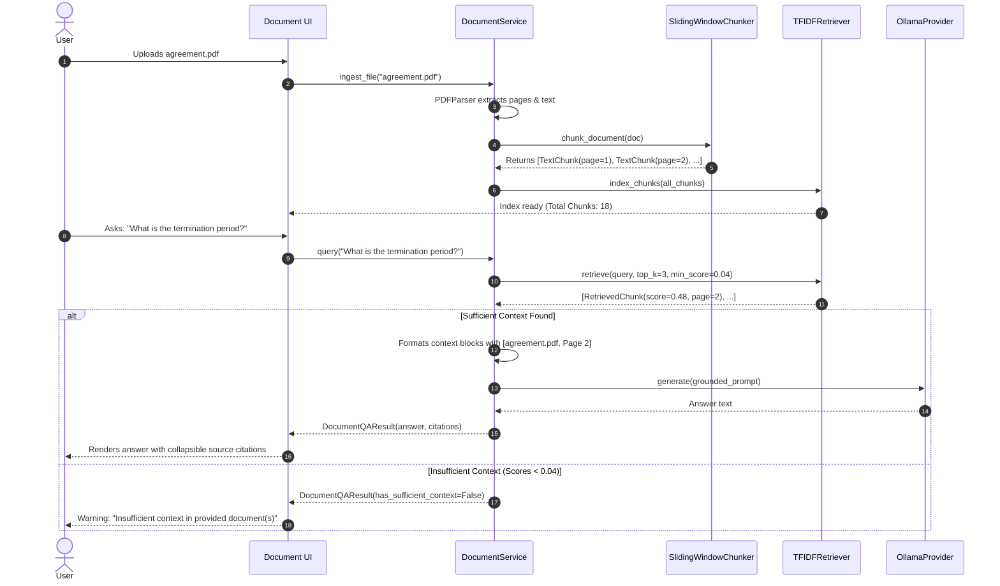

# System Architecture & Design Philosophy

`LocalAI — Private LLM Workbench` is engineered around four core principles:
1. **Zero External Dependencies / 100% Local Privacy:** Models, embeddings, and uploaded document data remain strictly on local workstation storage.
2. **Strict Layer Decoupling:** The Streamlit presentation layer has zero knowledge of model protocols or parsing logic; all business logic lives in clean Python services.
3. **Transparent Provider Abstraction:** Application code communicates with an abstract interface (`BaseLLMProvider`), allowing model runtimes to be swapped or extended without rewriting application services.
4. **No Heavy Framework Bloat:** Deliberately built without LangChain or LangGraph to provide microsecond-accurate benchmark timing, predictable behavior, and minimal runtime overhead.

---

## 1. High-Level System Architecture

---

## 2. Component Breakdown

### 2.1 Presentation Layer (`src/localai/ui/`)
* **Role:** Pure rendering and user interaction.
* **Guarantees:**
  * No database, HTTP, or parsing logic is written inside Streamlit views.
  * Pages consume typed service responses (`GenerationResult`, `DocumentQAResult`, `ExtractionEnvelope`, `BenchmarkReport`).
  * Custom dark workbench CSS (`src/localai/ui/styles.py`) enforces a developer-first aesthetic.

### 2.2 Application Services Layer (`src/localai/services/`)
* **`ChatService`:** Manages conversation history (`ChatMessage` objects), applies system prompts, handles streaming generation chunks, and updates session state.
* **`DocumentService`:** Coordinates the document lifecycle: parsing files, splitting into chunks, building the TF-IDF inverted index, running similarity searches, assembling grounded context, and formatting source citations.
* **`ExtractionService`:** Inspects Pydantic model schemas, generates JSON-enforcing system prompts, calls the LLM with `format="json"`, extracts raw JSON, and validates the dictionary through Pydantic.
* **`BenchmarkService`:** Executes a controlled suite of evaluation prompts across selected models, discards warm-up runs, and calculates statistical metrics (mean TTFT, throughput, and hardware memory peak).

### 2.3 Provider Abstraction Layer (`src/localai/providers/`)
* **`BaseLLMProvider`:** Defines an abstract contract:
  * `is_healthy() -> bool`
  * `list_models() -> List[ModelInfo]`
  * `chat(...) -> GenerationResult` & `chat_stream(...) -> Iterator[GenerationChunk]`
  * `generate(...) -> GenerationResult` & `generate_stream(...) -> Iterator[GenerationChunk]`
* **`OllamaProvider`:** Implements `BaseLLMProvider` using persistent `httpx.Client` sessions. Communicates directly with:
  * `/api/tags`: Model catalog and quantization details.
  * `/api/version`: Daemon health check.
  * `/api/chat`: Multi-turn chat completions.
  * `/api/generate`: Single-turn prompt completions.

---

## 3. Data Flow Sequences

### 3.1 Streaming Chat Sequence

### 3.2 Document Intelligence (RAG) Sequence

---

## 4. Key Engineering Decisions & Rationale

| Decision | Rationale | Alternatives Considered |
| :--- | :--- | :--- |
| **Direct `httpx` vs. LangChain** | Eliminates framework latency, avoids breaking upstream changes, and allows exact timestamping for TTFT and tokens/sec calculation. | LangChain / LlamaIndex (rejected: excessive abstraction, hidden timing overhead). |
| **Ollama Daemon vs. `llama-cpp-python`** | Treating Ollama as an external runtime mirrors real-world production environments where model serving is decoupled from application servers. | Embedding weights directly in Python (rejected: complicates Python memory management and multiprocessing). |
| **In-Memory TF-IDF vs. Vector DB** | Scikit-learn TF-IDF runs with 0ms startup, requires no external Docker services or vector databases (Chroma/Qdrant), and is 100% deterministic. | Vector DBs (Chroma/FAISS) (rejected: unnecessary complexity for single-workstation local demo). |
| **Pydantic Validation** | Provides strict type safety, automatic JSON Schema generation, and structured error reporting. | Manual regex or unvalidated `json.loads` (rejected: fragile and prone to hallucinated keys). |

